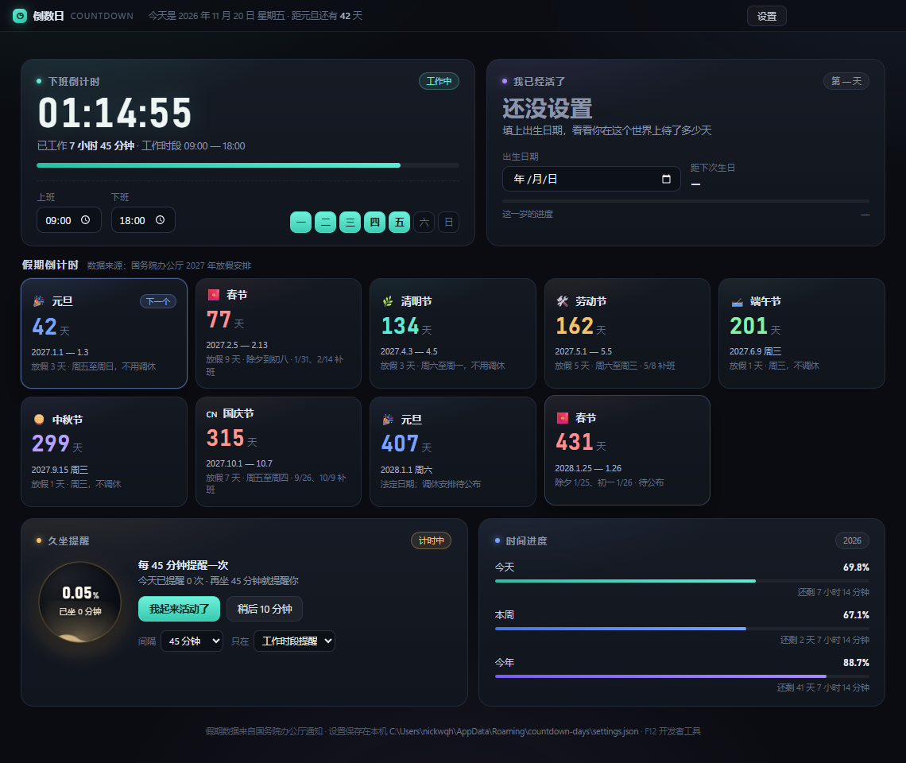
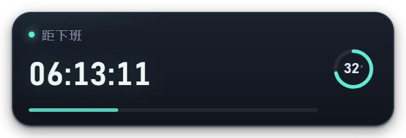

# 倒数日 · Countdown Days

> 一个常驻桌面的倒计时小工具：**还有几天放假、还有多久下班、已经活了多少天、坐了多久该起来动一动** —— 四件事，一屏看完。

Windows 桌面应用，Electron + Vue 3 + TypeScript 实现。深色界面，无边框自绘标题栏，收起后可变成贴在屏幕角落的迷你胶囊。



---

## 这个应用解决什么问题

打工人的时间感知是碎的：想知道还有几天到春节，得打开日历数；想知道今天还有多久下班，得心算；一坐三小时腰疼了才想起来该动一动。

「倒数日」把这几件事拼在一块常驻窗口里，打开就能看见，不用点、不用查、不用记。

| 你关心的事 | 应用里对应的卡片 |
| --- | --- |
| 还有几天放假 | 假期倒计时（9 个假期，含调休补班日） |
| 今天还要熬多久 | 下班倒计时（含工作时长进度条） |
| 我在这世上待了多少天 | 我已经活了（出生天数 + 距下次生日） |
| 我坐了多久 | 久坐提醒（水位球 + 系统通知） |
| 今年过去多少了 | 时间进度（今天 / 本周 / 今年） |

---

## 功能特性

### 1. 下班倒计时

- 大号数字显示距离下班还有多久，下面一条进度条显示今天的工作进度
- 上班 / 下班时间可在卡片上直接改，支持设置工作日（周一至周日任选，默认周一到周五）
- 非工作时间会切换成「已下班」「休息中」等状态，不会一直跳 00:00:00
- 支持"今天不上班"的判断：周末、法定假日、调休补班日都算进去了

### 2. 假期倒计时

- 9 张卡片覆盖**元旦、春节、清明、劳动节、端午、中秋、国庆**（2027 全年 + 2028 元旦 / 春节）
- 每张卡片标注：倒计时天数、假期起止日期、放假天数、**调休补班日**
- 数据来源：国务院办公厅《关于 2027 年部分节假日安排的通知》（国办发明电〔2026〕10 号）
- 已过的假期自动收进历史，离得最近的标上「下一个」
- 点右上角可打开**全年日历**，按月看假期、补班日，以及农历日期、二十四节气与传统节日（春节 / 元宵 / 腊八 / 小年 / 除夕…）

### 3. 我已经活了

- 填一次出生日期，算出你已经在这个世界上待了多少天
- 同时显示距离下次生日还有几天、这一岁过了多少（进度条）

### 4. 久坐提醒

- 默认每 45 分钟提醒一次，间隔可调，可限定「只在工作时段计时」
- 中间的**水位球**显示当前这一轮坐下的占比，越接近满就越该起来
- 提醒方式：应用内浮层 + 系统通知 + 任务栏图标闪烁（窗口在后台也不会漏）
- 两个按钮：`我起来活动了`（立即清零重算）、`稍后 10 分钟`（贪一会儿）
- 久坐计时跑在**主进程**里，窗口最小化、收进托盘、收起成胶囊都照常计时

### 5. 时间进度

- 今天、本周、今年三条进度条，右侧写清「还剩多久」
- 用来看「这一年又过去 X% 了」这种不太好受但很真实的事实

### 6. 迷你胶囊窗



- 快捷键 `Ctrl + Alt + D` 随时收起 / 展开
- 置顶小窗，只显示下班倒计时和久坐圆环，几乎不占地方
- 可拖动到任意位置，位置会记住，下次打开还在原地
- 独立入口打包，不加载 Element Plus，自身产物只有几 KB

### 7. 技术雷达（可选）

- 定时抓取 GitHub 上「最近 30 天创建、star ≥ 100」的新项目，按 star 排序
- 支持配置任意 OpenAI 兼容接口（`baseUrl` + `model` + API Key），让模型用中文总结这些项目在做什么
- 抓取调度放在主进程，并用 `powerMonitor` 处理笔记本睡眠唤醒后的补抓，不会因为 setInterval 堆积而连发好几轮

---

## 技术栈

| 层次 | 选型 | 说明 |
| --- | --- | --- |
| 桌面容器 | Electron 45 | 窗口、托盘、通知、全局快捷键、safeStorage |
| 界面框架 | Vue 3.5（`<script setup>` + Composition API） | 全部逻辑走 composables，组件只管画 |
| 语言 | TypeScript（严格模式） | `shared/types.ts` 约束 IPC 两端结构 |
| 组件库 | Element Plus | 只用于弹窗、表单、下拉等交互件，主题变量在 `src/styles/element.css` 覆写 |
| 构建 | Vite 8 + esbuild | 渲染进程走 Vite，主进程 / preload 走 esbuild |
| 打包 | electron-builder 26 | 输出 NSIS 安装包 + portable 免安装版 |
| 农历换算 | 构建期用 lunar-javascript 生成数据表，运行时自研换算器 | 见 `scripts/gen-calendar-data.mjs` 与 `src/utils/lunar.ts` |

---

## 快速开始

### 环境要求

- Node.js 20+
- Windows 10 / 11（打包脚本面向 Windows，其他平台需自行调整 `electron-builder` 配置）

### 安装与运行

```bash
git clone https://github.com/Isnick/countdown-days.git
cd countdown-days
npm install

npm run dev      # 开发模式：Vite 热更新 + Electron 自动重启
```

### 打包

```bash
npm run build        # 出 NSIS 安装包 + 免安装 portable 版，产物在 release/
npm run build:dir    # 只出解包目录，调试用，快很多
```

国内网络下 Electron 本体和 electron-builder 的工具包容易下载中断，`scripts/package.mjs` 默认已把镜像指向 npmmirror；想换回官方源，设置环境变量 `ELECTRON_MIRROR` / `ELECTRON_BUILDER_BINARIES_MIRROR` 覆盖即可。

### 全部命令

| 命令 | 作用 |
| --- | --- |
| `npm run dev` | 开发模式（Vite dev server + esbuild 编译主进程 + 拉起 Electron） |
| `npm run build:renderer` | 只构建渲染进程（两个页面入口：主界面、迷你胶囊） |
| `npm run build:electron` | 只用 esbuild 编译主进程 / preload |
| `npm run build` | 完整打包：构建 + electron-builder 出安装包 |
| `npm run build:dir` | 构建 + 只出解包目录（不生成安装包） |
| `npm run typecheck` | `vue-tsc` 全量类型检查 |

---

## 项目结构

```
├─ electron/                 主进程（Node 环境，只做必须碰系统的事）
│  ├─ main.ts                入口：窗口、托盘、快捷键、久坐通知
│  ├─ preload.ts             安全桥，只暴露白名单 API
│  ├─ ipc/register-ipc.ts    所有 IPC 处理器的注册处
│  └─ services/
│     ├─ window-manager.ts   主窗口创建、尺寸自适应、快捷键
│     ├─ mini-window.ts      迷你胶囊窗
│     ├─ tray.ts             托盘与关闭行为（询问 / 收进托盘 / 退出）
│     ├─ sit-service.ts      久坐计时器
│     ├─ settings-store.ts   设置读写与消毒
│     ├─ secrets-store.ts    API Key 加密存储（safeStorage）
│     ├─ trending-service.ts 技术雷达抓取调度
│     └─ ai-service.ts       OpenAI 兼容接口调用
│
├─ src/                      渲染进程（Vue 3）
│  ├─ App.vue                页面骨架 + 数据装配
│  ├─ components/            按功能分目录的组件
│  │  ├─ work/               下班倒计时
│  │  ├─ holiday/            假期卡片
│  │  ├─ life/               我已经活了
│  │  ├─ sit/                久坐提醒（卡片 / 水位球 / 浮层）
│  │  ├─ progress/           时间进度
│  │  ├─ calendar/           全年日历弹窗
│  │  ├─ trending/           技术雷达
│  │  ├─ settings/           设置弹窗
│  │  └─ layout/             标题栏、页脚
│  ├─ composables/           可复用的响应式逻辑（时钟、设置、久坐、假期…）
│  ├─ mini/                  迷你胶囊窗的独立入口与组件
│  ├─ styles/                设计令牌、基础样式、Element Plus 覆写
│  └─ utils/                 纯函数：日期、农历、节假日、音效
│
├─ shared/                   主进程与渲染进程共享
│  ├─ constants.ts           唯一的配置入口（见下）
│  ├─ types.ts               跨进程类型定义，保证 IPC 两端字段一致
│  └─ date.ts                共用的日期工具
│
├─ scripts/                  构建 / 开发 / 打包脚本
└─ docs/screenshots/         README 用截图
```

---

## 架构上的几个取舍

**主进程只管"必须碰系统"的事。** 开窗口、写磁盘、发通知、开托盘 —— 其他的倒计时计算全在渲染进程。这样主进程代码很少，出问题的地方集中；渲染进程也不至于因为拿不到 Node 能力而别扭。

**`shared/` 是唯一的真相来源。** IPC 通道名、设置结构、默认值、假期表、文案都放在 `shared/constants.ts` 和 `shared/types.ts`，两端引用同一份，不存在"主进程改了字段名、页面还在读老字段"这种事。想改行为，先看这个文件。

**两个页面两个入口。** 主界面引 Element Plus，构建后 JS + CSS 约 600 KB；迷你胶囊单独一个 HTML 入口，不引组件库，自身产物只有几 KB。它要一直挂在桌面上，多背一份组件库不值得。

**CSP 按环境注入。** 开发态放行 Vite 的 ws 和 eval，打包后收紧到只允许 `file:`。写在 `vite.config.mts` 的插件里，构建时替换掉 `<!--CSP-->` 占位。

**窗口不可见时暂停无限动画。** 最小化 / 收进托盘后给根节点挂 `app-idle` 标记，CSS 据此停掉水位球和光晕 —— 它们每秒都要合成一层，长时间开着会一点点吃内存和显存。

**省内存模式。** 设置里可以关掉硬件加速，GPU 进程常驻内存能降一百多 MB，代价是动画交给 CPU 画。这个开关必须在 `app.ready` 之前决定，所以启动时同步读一次盘。

---

## 数据与隐私

- **所有设置只存在本机**：`%APPDATA%\countdown-days\settings.json`
- 技术雷达用到的 API Key 单独存在 `secrets.json`，Windows 上走 Electron `safeStorage`（底层 DPAPI，绑定当前用户）；没有可用 keyring 的环境会退回 base64 并给出警告 —— 那不是加密，只是编码
- 除了技术雷达的 GitHub 搜索请求和你主动配置的 AI 接口外，应用不发起任何网络请求，也没有埋点和上报
- 假期数据是写死在 `shared/constants.ts` 里的，每年国办发文后手动追加一段

---

## 常见改动点

| 想改什么 | 改哪里 |
| --- | --- |
| 默认上下班时间、工作日 | `shared/constants.ts` → `DEFAULTS` |
| 窗口尺寸、标题栏配色 | `shared/constants.ts` → `APP.window` |
| 假期与调休安排 | `shared/constants.ts` → `HOLIDAY_TABLE` |
| 久坐间隔上限、稍后提醒时长 | `shared/constants.ts` → `LIMITS` / `OPTIONS` |
| 主题色、间距 | `src/styles/tokens.css` |
| 某个卡片的布局 | `src/components/<功能>/` 下对应组件 |
| 安装包名称、图标、目标平台 | `package.json` → `build` |

---

## 已知限制

- 假期表是**静态数据**，2028 年及以后的安排要等国办发文后手动补；目前 2028 元旦 / 春节标的是"法定日期，调休待公布"
- 打包配置只做了 Windows（NSIS + portable），macOS / Linux 需要补 `build.mac` / `build.linux` 段
- 技术雷达依赖 GitHub 搜索接口的速率限制，未配 Token 时额度较低，可能抓不全
- 农历换算依赖 `lunar-javascript`，极端年份的闰月边界未做额外校验

---

## License

MIT
